# PSOC&trade; Edge MCU: Bluetooth&reg; LE GATT caching client

This code example demonstrates the use of a dynamic Bluetooth&reg; Low Energy system using a caching mechanism between a Bluetooth&reg; LE Server and Bluetooth&reg; LE Client. The project shows reliable Bluetooth&reg; LE interaction by combining hash-based validation, runtime database updates, and clear recovery from out-of-sync conditions. The client application works to detect changes, perform discovery when required, and maintain consistent operation. This creates a complete reference for building Bluetooth&reg; LE systems with evolving GATT structures.

This code example has a three project structure: CM33 secure, CM33 non-secure, and CM55 projects. All three projects are programmed to the external QSPI flash and executed in Execute in Place (XIP) mode. Extended Boot launches the CM33 secure project from a fixed location in the external flash, which then configures the protection settings and launches the CM33 non-secure application. Additionally, CM33 non-secure application enables CM55 CPU and launches the CM55 application.

[View this README on GitHub.](https://github.com/Infineon/mtb-example-psoc-edge-btstack-gatt-caching-client)

[Provide feedback on this code example.](https://yourvoice.infineon.com/jfe/form/SV_1NTns53sK2yiljn?Q_EED=eyJVbmlxdWUgRG9jIElkIjoiQ0UyNDIzODEiLCJTcGVjIE51bWJlciI6IjAwMi00MjM4MSIsIkRvYyBUaXRsZSI6IlBTT0MmdHJhZGU7IEVkZ2UgTUNVOiBCbHVldG9vdGgmcmVnOyBMRSBHQVRUIGNhY2hpbmcgY2xpZW50IiwicmlkIjoibW9oYW5rdW1hci5yYW1ha3Jpc2huYXBhZG1hQGluZmluZW9uLmNvbSIsIkRvYyB2ZXJzaW9uIjoiMS4wLjAiLCJEb2MgTGFuZ3VhZ2UiOiJFbmdsaXNoIiwiRG9jIERpdmlzaW9uIjoiTUNEIiwiRG9jIEJVIjoiSUNXIiwiRG9jIEZhbWlseSI6IlBTT0MifQ==)

See the [Design and implementation](docs/design_and_implementation.md) for the functional description of this code example.

## Requirements

- [ModusToolbox&trade;](https://www.infineon.com/modustoolbox) v3.6 or later (tested with v3.6)
- Board support package (BSP) minimum required version: 1.0.0
- Programming language: C
- Associated parts: All [PSOC&trade; Edge MCU](https://www.infineon.com/products/microcontroller/32-bit-psoc-arm-cortex/32-bit-psoc-edge-arm) parts

## Supported toolchains (make variable 'TOOLCHAIN')

- GNU Arm&reg; Embedded Compiler v14.2.1 (`GCC_ARM`) – Default value of `TOOLCHAIN`
- Arm&reg; Compiler v6.22 (`ARM`)
- IAR C/C++ Compiler v9.50.2 (`IAR`)
- LLVM Embedded Toolchain for Arm&reg; v19.1.5 (`LLVM_ARM`)

## Supported kits (make variable 'TARGET')

- [PSOC&trade; Edge E84 Evaluation Kit](https://www.infineon.com/KIT_PSE84_EVAL) (`KIT_PSE84_EVAL_EPC2`) – Default value of `TARGET`
- [PSOC&trade; Edge E84 Evaluation Kit](https://www.infineon.com/KIT_PSE84_EVAL) (`KIT_PSE84_EVAL_EPC4`)

## Hardware setup

This example uses the board's default configuration. See the kit user guide to ensure that the board is configured correctly.

Ensure the following jumper and pin configuration on board.
- BOOT SW must be in the HIGH/ON position
- J20 and J21 must be in the tristate/not connected (NC) position

To verify the output, two PSOC&trade; kits are required: one for the Bluetooth&reg; LE GATT caching client and the other for the Bluetooth&reg; LE GATT caching server.

Program the [Bluetooth&reg; LE GATT caching server](https://github.com/Infineon/mtb-example-psoc-edge-btstack-gatt-caching-server) code example to run as Bluetooth&reg; LE GATT caching server on the second kit.

## Software setup

See the [ModusToolbox&trade; tools package installation guide](https://www.infineon.com/ModusToolboxInstallguide) for information about installing and configuring the tools package.

Install a terminal emulator if you do not have one. Instructions in this document use [Tera Term](https://teratermproject.github.io/index-en.html).

## Operation

See [Using the code example](docs/using_the_code_example.md) for instructions on creating a project, opening it in various supported IDEs, and performing tasks, such as building, programming, and debugging the application within the respective IDEs.

> **Note:** Use another PSOC&trade; Edge MCU Kit and program it with the [PSOC&trade; Edge MCU: Bluetooth&reg; LE GATT caching server](https://github.com/Infineon/mtb-example-psoc-edge-btstack-gatt-caching-server) code example.

1. Connect the board to your PC using the provided USB cable through the KitProg3 USB connector

2. Open a terminal program and select the KitProg3 COM port. Set the serial port parameters to 8N1 and 115200 baud

3. After programming, the application starts automatically. Observe the Bluetooth&reg; stack and application trace messages on the UART terminal connected via KitProg3 COM port

   **Figure 1** shows the output, if:
   
   - The kit is programmed for the first time where the identity keys need to be generated newly and is not available in the non-volatile memory (NVM)
   
   or
   
   - The identity keys (bonding information) are cleared by pressing and holding the **USER BTN1 (SW2)** for more than three seconds. Because the Key Value (KV) store library has been reset, reset the device to generate new keys, the Bluetooth&reg; stack requests new identity keys, generates them, and saves them to NVM. After initialization, the GATT database is setup, the initial database hash is calculated and already displayed with the PEER INFO as all reset (e.g., you can see all values set as '0')

   **Figure 1. Log messages on KitProg3 COM port (device initialized without pairing or reset after kv-store reset)**

   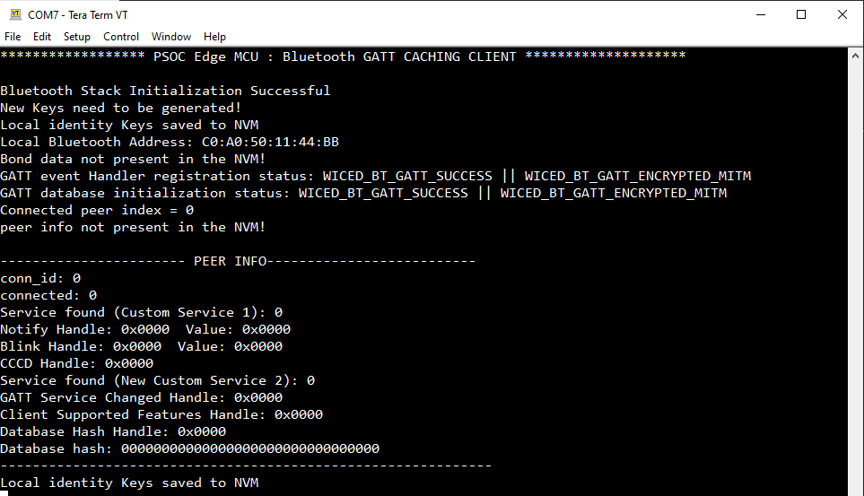

   **Figure 2** shows the following output, if:
  
   - The kit is programmed and the device is previously paired, which means the identity keys are already stored in the database

   - The client has completed its initialization and identity key handling. After a few seconds with no active Bluetooth&reg; LE connection, the server reads the stored identity keys from NVM for verification

   - The GATT database is reinitialized successfully, the same database hash is displayed, and the PEER INFO remains unchanged because no new connection has occurred yet

   **Figure 2. Log messages on KitProg3 COM port (device initialized with pairing or identity keys present)**

   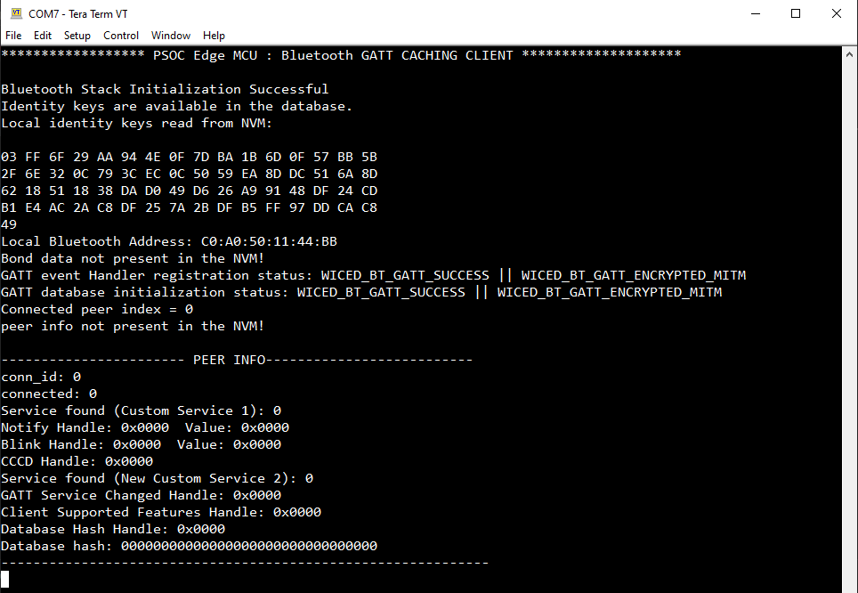

   The functionality of the client side user buttons are as follows:

   **USER BTN1**

   The **USER BTN1** manages the dynamic GATT service and performs KV-store resets, and is defined as follows:

  - **Long press (more than three seconds): Resets KV-Store library**
     
    A long press of more than three seconds triggers a full reset of the KV-store library

    - Clears stored identity keys
    - Removes bonding information
    - Resets all cached Bluetooth&reg; LE state
    - Next boot behaves like first-time initialization

    > **Note:** After performing a KV-store reset, always press the hardware RESET button on the device, which ensures that all cleared keys and GATT database entries are fully reinitialized

    **Figure 3. Log output showing KV-store reset**

    

  - **Short press when no service added by server**

    A short press sends a read request to the server. The client receives the Custom Service 1 characteristic value because the new Custom Service 2 has not yet been added to the database

    **Figure 4. Log output showing successful read of Custom Service 1 data**

    

  - **Short press when service added by server**

    If the server has added the new service, pressing the **USER BTN1** again sends a read request to the server. If the service is added and the Service Changed Indication is subscribed, the client receives the indication and starts service discovery. After the discovery completes, the New Custom Service 2 characteristic value becomes readable

    **Figure 5. Successful received indication of service added**

    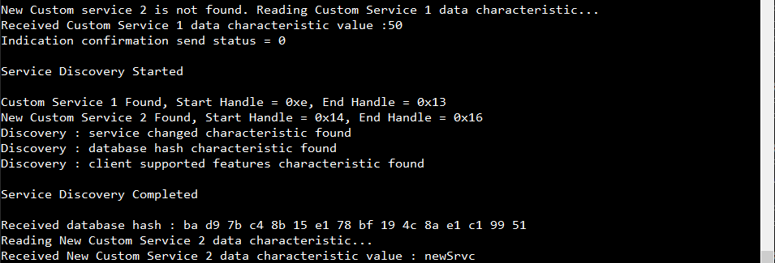

    If the service is added and the Service Changed Indication is not subscribed, the next read request results in a Database Out of Sync error, or after a reset the client detects a hash mismatch and starts discovery. After the discovery completes, the New Custom Service 2 data characteristic becomes readable successfully

    **Figure 6. Database Out Of Sync Error and rediscovery**
    
    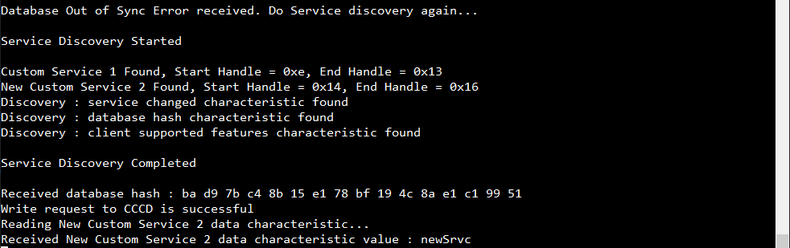
    
  - **Short press when service removed by server**

    If the server has removed the new service, pressing **USER BTN1** again sends a read request to the server. If the service is removed and the Service Changed Indication is subscribed, the client receives the indication and starts service discovery. After the discovery completes, the New Custom Service 2 data characteristic is not found, and the Custom Service 1 data characteristic remains readable successfully

    **Figure 7. Successfully received indication of service removed**

    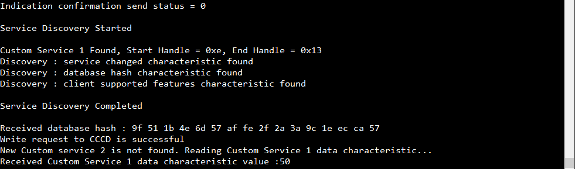

    After the server removes the dynamic service, a read request for New Custom Service 2 results in a Database Out-of-Sync error if the Service Changed Indication is not subscribed. The client then automatically initiates service discovery. After discovery, the characteristic is no longer available. A subsequent button press shows that the service is not found, while the Custom Service 1 data characteristic continues to read normally

    **Figure 8. Log output showing Database Out Of Sync error and rediscovery**

    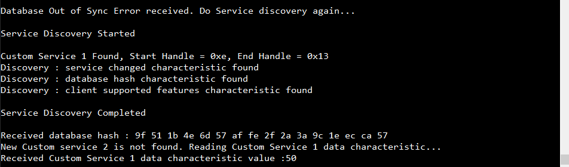

  **USER BTN2**

   The **USER BTN2** is used to toggle the Service Changed Indication subscription or to start Bluetooth&reg; LE scanning and initiate a connection to the server device. The server advertises automatically, and the client connects upon discovering it.

   - **Long press (more than three seconds): Toggle Service Changed Indication**

     A long press of **USER BTN2** (held for more than three seconds) toggles the Service Changed Indication subscription state on the client. Each long press switches the state:

      - First long press: Subscribes to the Service Changed Indication by writing 0x02 0x00 to the Service Changed CCCD

      - Second long press: Unsubscribes from the Service Changed Indication by writing 0x00 0x00 to the Service Changed CCCD
      
     Further long presses continue toggling the feature in a cyclic way. This allows dynamic testing of both the Subscribed and Unsubscribed Service Changed Indication scenarios

  - **Short press (when not connected): Start scanning and connect**

    When the client has no active Bluetooth&reg; LE connection, pressing `USER BTN2` starts scanning and attempts to initiate a GATT connection.

    **Figure 9. Scan started and peer detected**

    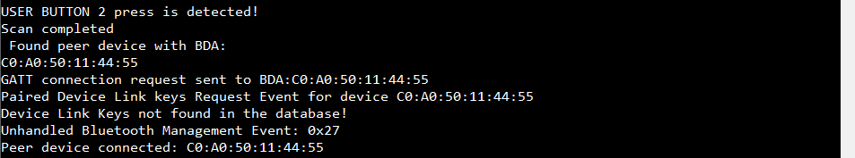

  - **Short press (when already connected)**

    If the client is **already connected** to the server, pressing `USER BTN2` still triggers a scan request. However, because an active connection already exists, the connection attempt fails and the system logs as follows:

    **"USER BUTTON 2 press is detected!"**

4. For connection establishment, when the application starts on client side begins the scanning by pressing the **USER BTN2** for making the connection with the server where server starts advertising automatically when application started on server side

   - After successful connection with the server on the client side, see the connection ID and local Bluetooth&reg; address of the server and do service discovery on initial connection stay sync with the server

     **Figure 10. Connection established**

     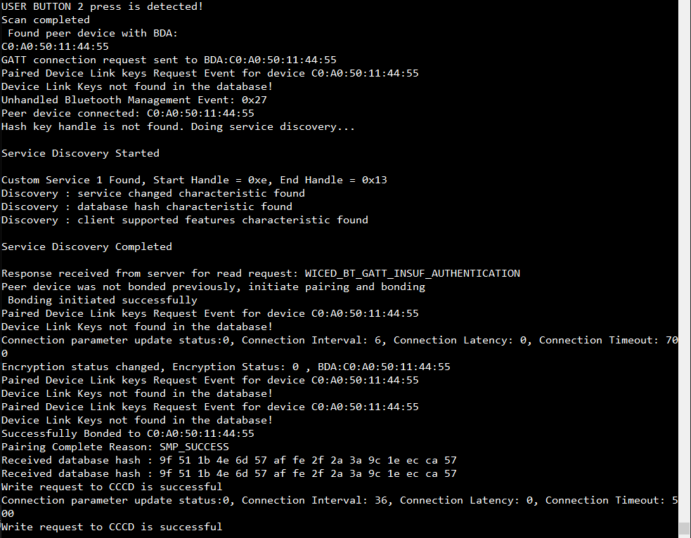

   - If the server later disconnects, the client gets the message that the peer device disconnected with its address and when the server powers on the server automatically restarts advertising. This ensures that the client can reconnect at any time by scanning again, with no manual intervention required on the server side, just press **USER BTN1** on the client side

     **Figure 11. Server disconnects**

     

5. When the server and client are actively connected, the GATT database can change dynamically based on **USER BTN1** interactions on server side. This triggers two distinct behaviors depending on whether a service can be **added** or **removed**

   > **Note:** Long-pressing **USER BTN2** (for more than three seconds) toggles the Service Changed Indication feature. Each long press switches the state, the first long press **enables** Service Changed Indications, the next **disables** them, and the cycle continues, allowing repeated testing of both indication-enabled and indication-disabled scenarios

   **Case 1: Service added** 

   When **USER BTN1** is pressed first in the cycle from server:

   - The server adds a new custom service dynamically to the GATT database
   - The GATT Database Hash updates immediately
   - If the Service Changed Indication is subscribed, the Service Changed Indication is received from the connected server
   - The client sends back an Indication Confirmation to the server
   - The client automatically begins full service discovery to resynchronize its GATT cache
   - After discovery completes, the client can now read the New Custom Service 2 characteristic value of the added service and also the database hash will be updated and it can be verifiable that both side database hash matches

   **Figure 12. Service addition and indication-based rediscovery**

   

   If the service is added and Service Changed Indication is unsubscribed, the next read request results in a Database Out of Sync Error, or after a reset the client detects a hash mismatch and starts discovery and the New Custom Service 2 data characteristic value is readable successfully 

   **Figure 13. Database Out Of Sync error and rediscovery**

   
   

   **Case 2: Service removed**

   When **USER BTN1** is pressed second in the cycle from server:

   If the server has removed the new service, pressing **USER BTN1** again sends a read request to the server. As the Service Changed Indication is subscribed, the client receives the indication and starts service discovery. After the discovery completes, the New Custom Service 2 data characteristic is no longer found, while the Custom Service 1 data characteristic continues to be read successfully

   **Figure 14. Successfully received indication of service removed**

   

   If the service is removed while the Service Changed Indication is not subscribed, the server silently updates the GATT Database Hash

   - The database changes without notifying the client
   - As the Service Changed Indication is not subscribed, the client remains unaware of the update until it performs an operation involving the removed service

   In this scenario, when the client sends a Read Request for the New Custom Service 2 characteristic value, the server responds with a Database Out-of-Sync error. The client detects this error and immediately initiates full service discovery. After rediscovery, the client confirms that New Custom Service 2 no longer exists, and it is able to read the Custom Service 1 data characteristic value successfully. This cycle validates correct handling of dynamic GATT service removal when the Service Changed Indication is not subscribed

   **Figure 15. Service removal and NO indication-based rediscovery**

   

   A detailed explanation of this sequence is provided in **Figure 3** as a flowchart in the [Design and implementation](./docs/design_and_implementation.md) section

6. The client uses a GATT Database Hash–based synchronization mechanism to remain aligned with any changes made on the server. Depending on the connection state and database updates, the client behaves under three distinct scenarios

   - **Initial connection: No prior database information**

     When the client connects to the server for the first time, it has:

     - No cached service information  
     - No stored database hash  
     - `PEER INFO` values set to zero  

     Because it is an initial connection, the client:

     - Performs a full GATT service discovery  
     - Reads the server’s Database Hash characteristic
     - Stores the new hash and updates the `PEER INFO` table  
     - Synchronizes completely with the server’s GATT database  

     Because no previous reference hash exists, the hash key handle is not found, so it performs service discovery again

     **Figure 16. Client state before first connection (PEER INFO empty)**  

     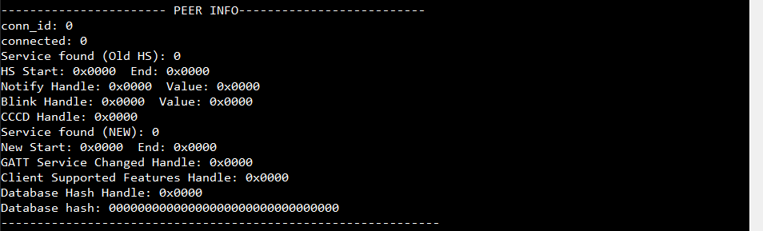

     **Figure 17. Full service discovery on first connection**

     

     **Figure 18. PEER INFO after synchronization**

     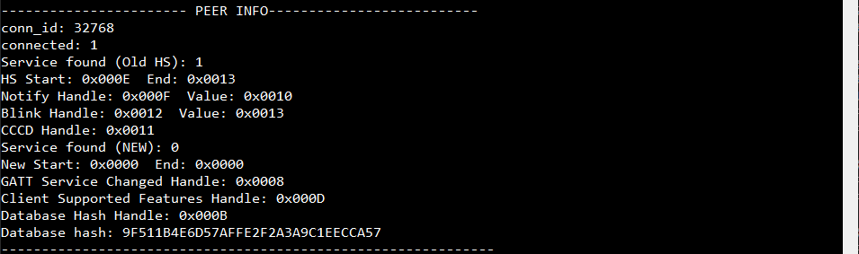

   - **Database updated on server: Client detects mismatch**

     If the server adds or removes a service while the client is not connected, it is GATT database changes and a new database hash is generated

     When the client reconnects (or resets and reconnects):

      - It reads the server’s database hash  
      - Compares it with the previously stored hash  
      - Detects a mismatch 
      - Triggers full service discovery automatically  
      - Re-synchronizes its internal GATT cache  
      - Updates `PEER INFO` with the new hash  

     This ensures that the client always stays in sync with dynamic server databases

     **Figure 19. Client detects hash mismatch and triggers discovery**

     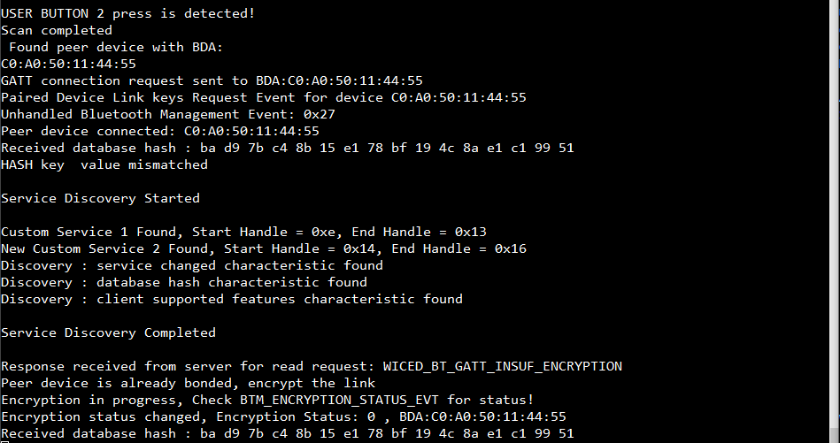

     **Figure 20. New hash stored after rediscovery**

     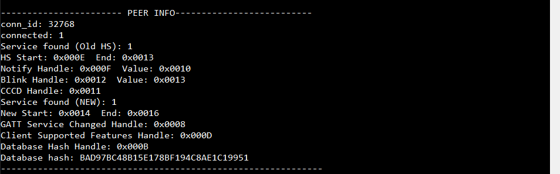

  - **No database change: Hash matches, discovery skipped**

    If the server’s GATT database has not changed since the last client connection:

     - The database hash read by the client matches the stored hash  
     - The client skips full service discovery  
     - Proceeds directly with normal communication  
     - `PEER INFO` remains unchanged  

    This scenario confirms that the databases are already synchronized

    **Figure 21. Client reads matching hash and skips discovery**

    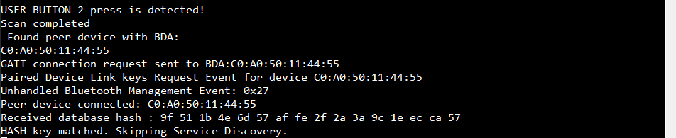

    **Figure 22. PEER INFO unchanged (hash remains valid)**  

    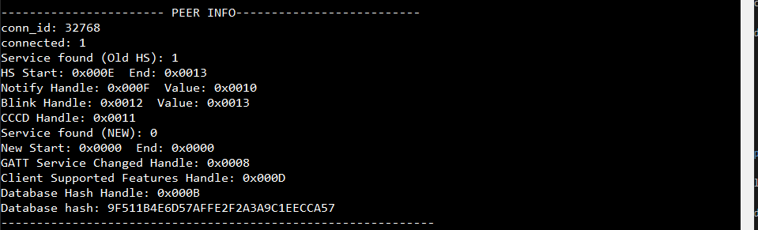

    A detailed explanation of this sequence is provided in **Figure 2** as a flowchart in the [Design and implementation](./docs/design_and_implementation.md) section

## Resources and settings

This section explains the ModusToolbox&trade; software resources and their configurations as used in this code example. Note that all the configuration explained in this section has already been implemented in the code example.

- **Bluetooth&reg; Configurator:** The Bluetooth&reg; peripheral has a configurator called the “Bluetooth&reg; Configurator” that is used to generate the Bluetooth&reg; LE GATT database and various Bluetooth&reg; settings for the application. These settings are stored in the file named *design.cybt*.

See the [Bluetooth&reg; Configurator guide](https://www.infineon.com/ModusToolboxBLEConfig) for more details.

## Related resources

Resources  | Links
-----------|----------------------------------
Application notes  | [AN235935](https://www.infineon.com/AN235935) – Getting started with PSOC&trade; Edge E8 MCU on ModusToolbox&trade; software   [AN236697](https://www.infineon.com/AN236697) – Getting started with PSOC&trade; MCU and AIROC&trade; Connectivity devices
Code examples  | [Using ModusToolbox&trade;](https://github.com/Infineon/Code-Examples-for-ModusToolbox-Software) on GitHub
Device documentation | [PSOC&trade; Edge MCU datasheets](https://www.infineon.com/products/microcontroller/32-bit-psoc-arm-cortex/32-bit-psoc-edge-arm#documents)   [PSOC&trade; Edge MCU reference manuals](https://www.infineon.com/products/microcontroller/32-bit-psoc-arm-cortex/32-bit-psoc-edge-arm#documents)
Development kits | Select your kits from the [Evaluation board finder](https://www.infineon.com/cms/en/design-support/finder-selection-tools/product-finder/evaluation-board)
Libraries  | [mtb-dsl-pse8xxgp](https://github.com/Infineon/mtb-dsl-pse8xxgp) – Device support library for PSE8XXGP   [retarget-io](https://github.com/Infineon/retarget-io) – Utility library to retarget STDIO messages to a UART port   [btstack-integration](https://github.com/Infineon/btstack-integration) – The btstack-integration hosts platform adaptation layer (porting layer) between AIROC&trade; BTSTACK and Infineon's different hardware platforms   [kv-store](https://github.com/Infineon/kv-store) – This library provides a convenient way to store information as key-value pairs in non-volatile storage
Tools  | [ModusToolbox&trade;](https://www.infineon.com/modustoolbox) – ModusToolbox&trade; software is a collection of easy-to-use libraries and tools enabling rapid development with Infineon MCUs for applications ranging from wireless and cloud-connected systems, edge AI/ML, embedded sense and control, to wired USB connectivity using PSOC&trade; Industrial/IoT MCUs, AIROC&trade; Wi-Fi and Bluetooth&reg; connectivity devices, XMC&trade; Industrial MCUs, and EZ-USB&trade;/EZ-PD&trade; wired connectivity controllers. ModusToolbox&trade; incorporates a comprehensive set of BSPs, HAL, libraries, configuration tools, and provides support for industry-standard IDEs to fast-track your embedded application development

 

## Other resources

Infineon provides a wealth of data at [www.infineon.com](https://www.infineon.com) to help you select the right device, and quickly and effectively integrate it into your design.

## Document history

Document title: *CE242381* – *PSOC&trade; Edge MCU: Bluetooth&reg; LE GATT caching client*

 Version | Description of change
 ------- | ---------------------
 1.0.0   | GitHub release
 

All referenced product or service names and trademarks are the property of their respective owners.

The Bluetooth&reg; word mark and logos are registered trademarks owned by Bluetooth SIG, Inc., and any use of such marks by Infineon is under license.

PSOC&trade;, formerly known as PSoC&trade;, is a trademark of Infineon Technologies. Any references to PSoC&trade; in this document or others shall be deemed to refer to PSOC&trade;.

---------------------------------------------------------

(c) 2025, Infineon Technologies AG, or an affiliate of Infineon Technologies AG. All rights reserved.
This software, associated documentation and materials ("Software") is owned by Infineon Technologies AG or one of its affiliates ("Infineon") and is protected by and subject to worldwide patent protection, worldwide copyright laws, and international treaty provisions. Therefore, you may use this Software only as provided in the license agreement accompanying the software package from which you obtained this Software. If no license agreement applies, then any use, reproduction, modification, translation, or compilation of this Software is prohibited without the express written permission of Infineon.
 
Disclaimer: UNLESS OTHERWISE EXPRESSLY AGREED WITH INFINEON, THIS SOFTWARE IS PROVIDED AS-IS, WITH NO WARRANTY OF ANY KIND, EXPRESS OR IMPLIED, INCLUDING, BUT NOT LIMITED TO, ALL WARRANTIES OF NON-INFRINGEMENT OF THIRD-PARTY RIGHTS AND IMPLIED WARRANTIES SUCH AS WARRANTIES OF FITNESS FOR A SPECIFIC USE/PURPOSE OR MERCHANTABILITY. Infineon reserves the right to make changes to the Software without notice. You are responsible for properly designing, programming, and testing the functionality and safety of your intended application of the Software, as well as complying with any legal requirements related to its use. Infineon does not guarantee that the Software will be free from intrusion, data theft or loss, or other breaches (“Security Breaches”), and Infineon shall have no liability arising out of any Security Breaches. Unless otherwise explicitly approved by Infineon, the Software may not be used in any application where a failure of the Product or any consequences of the use thereof can reasonably be expected to result in personal injury.
