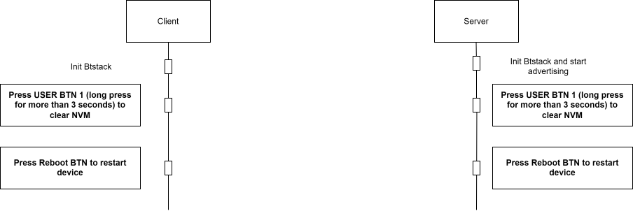
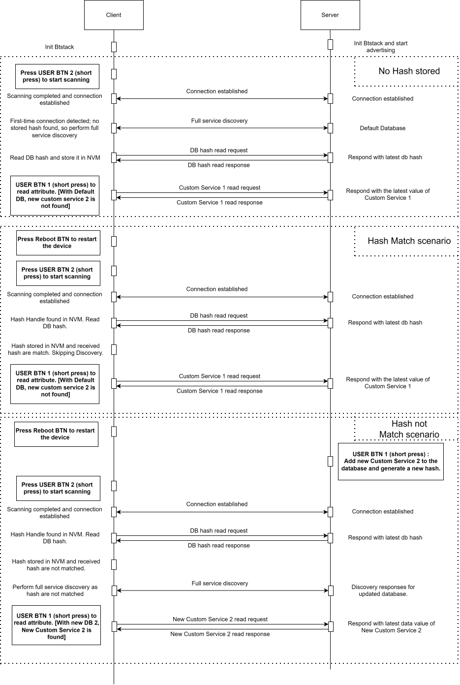

[Click here](../README.md) to view the README.

## Design and implementation

The design of this application is minimalistic to get started with code examples on PSOC&trade; Edge MCU devices. All PSOC&trade; Edge E84 MCU applications have a dual-CPU three-project structure to develop code for the CM33 and CM55 cores. The CM33 core has two separate projects for the secure processing environment (SPE) and non-secure processing environment (NSPE). A project folder consists of various subfolders, each denoting a specific aspect of the project. The three project folders are as follows:

**Table 1. Application projects**

Project | Description
--------|------------------------
*proj_cm33_s* | Project for CM33 secure processing environment (SPE)
*proj_cm33_ns* | Project for CM33 non-secure processing environment (NSPE)
*proj_cm55* | CM55 project

 

In this code example, at device reset, the secure boot process starts from the ROM boot with the Secure Enclave (SE) as the root of trust (RoT). From the secure enclave, the boot flow is passed on to the system CPU subsystem where the secure CM33 application starts. After all necessary secure configurations, the flow is passed on to the non-secure CM33 application. Resource initialization for this example is performed by this CM33 non-secure project. It configures the system clocks, pins, clock to peripheral connections, and other platform resources. It then enables the CM55 core using the `Cy_SysEnableCM55()` function and the CM55 core is subsequently put to DeepSleep mode.

In the CM33 non-secure application, the clocks and system resources are initialized by the BSP initialization function. The retarget-io middleware is configured to use the debug UART. Platform-specific settings for the Bluetooth&reg; device are configured, BTSTACK is initialized, and callback functions are registered. Events handlers are written to handle the BTSTACK callback events.

The code example configures the device as a Bluetooth&reg; LE Generic Access Profile (GAP) Central and a Generic Attribute Profile (GATT) Client. It demonstrates how to read, write, and subscribe to indications/notifications from the server's two custom GATT services and three Generic Attribute Service characteristics: Service Changed, Database Hash, and Client Supported Features.

The Service Changed characteristic contains a Client Characteristic Configuration Descriptor (CCCD), which allows the client to subscribe or unsubscribe to its indication. Once subscribed, the server uses this indication to notify the client whenever a service is added to or removed from the GATT database, ensuring the client becomes aware of structural changes.

The Database Hash characteristic provides a hash value representing the current state of the entire GATT database. The client reads this value and compares it with the previously stored hash to determine whether its cached database is still valid or out of sync.

Upon reset, the application starts and initializes BTSTACK along with other device peripherals. The device then begins scanning for a server when **USER BTN2** is pressed. Once a Bluetooth&reg; LE connection is established, the client can enable Service Changed Indications by writing to the CCCD of the Service Changed characteristic through a long press of USER BTN2. This allows the server to notify the client whenever any service is added or removed from the GATT database.

The buttons, such as user button 1 and button 2 on the board have been set up to generate an interrupt upon being pressed, and it can perform the following functions when pressed.

- **USER Button 1 (SW2): Client side**

  **Short press**
  Sends a read request to the server for the custom service data as follows:

  - Custom Service 1: If the previous discovery does not include information related to the new Custom Service 2
  - Custom Service 2: If the previous discovery includes information related to the new Custom Service 2

  **Long press (more than three seconds)**
    
  Performs a full **KV-store reset** (clears bonding info, identity keys, cached handles, and database (DB) hash). After reset, press the hardware RESET button to restart as first-time initialization

- **USER Button 2 (SW4): Client side**

  **Short press**  

  Triggers Bluetooth&reg; LE scanning and connection to the server when not connected. If already connected, the press is ignored for connection purposes

  **Long press (more than three seconds)** 

  Toggles Service Changed Indication support on the client (cyclic):

    - First long press: Subscribes to Service Changed Indication (default state after factory reset)
    - Second long press: Unsubscribes from Service Changed Indication

    - Subsequent long presses: Alternate between subscribing and unsubscribing.

  When unsubscribed, the client ignores incoming Service Changed indications and relies solely on hash validation or Out-of-Sync error
  
**Figure 1** shows that when each device powered on and if kv-store still has data of previous connection, performs a long press on **USER BTN1** (held for more than three seconds) to erase all stored information from non-volatile memory (NVM), ensuring that previously bonded peers, keys, and Bluetooth&reg; LE state are fully cleared. Once the NVM reset is triggered, both devices require a manual reboot using the reboot button to reinitialize the stack and start with a clean state. This coordinated reset process guarantees that future pairing, service discovery, and GATT database interactions occur without leftover cached data, enabling consistent and predictable behavior during testing or reconfiguration.

**Figure 1. NVM clear scenario flowchart**

**Figure 2** shows that the device maintains a DB hash in NVM to track the version of the database. On every Bluetooth&reg; LE connection, the client first reads the current DB hash from the server and compares it with the locally stored value, enabling three scenarios:

- **Scenario 1: No hash stored**

  When the device has never connected before or has been reset, no DB hash exists in NVM. After connection, the client performs full service discovery, reads, and stores the server's DB hash, then reads all required characteristics (e.g., Custom Service 1). The device is now synchronized

- **Scenario 2: Hash match**
  
  On subsequent connections (after reboot or normal power-on), the device already has a hash stored in NVM. After connection is established, the client sends a DB hash read request. The server replies with the latest hash. The client compares it with the one stored in NVM; if they match, the hashes are identical, so the local database is up to date. The client skips full service discovery and reads "Custom Service 1" or "New Custom Service 2" on a button press. The server responds with the latest value of Custom Service 1 or new custom service 2

- **Scenario 3: Hash do not match**

  On subsequent connections (after reboot or normal power-on), the device already has a hash stored in NVM. After connection is established, the client sends a DB hash read request. The server replies with the latest hash. The client compares it with the one stored in NVM. If the server's DB hash differs from the one in the client's NVM, the client detects the mismatch after the DB hash read exchange. It then performs a full service discovery because the database structure may have changed. Upon discovering the updated services, the client finds a new "New Custom Service 2" that did not exist before. It reads this new service/characteristic, and the server responds with the latest data. Simultaneously (or as a side action), the client adds the new Custom Service 2 entry to its local database and generates/overwrites the DB hash in NVM with the new value received from the server

**Figure 2. Hash validation scenario flowchart**

When the Service Changed Indication is not subscribed, the client cannot receive real-time notification of changes to the server's database. If the server updates its GATT database during an active connection, for example, by adding New Custom Service 2, it generates a new database hash and marks the client internally as Cache-UNWARE. As the client is not subscribed to indications, the server cannot send a Service Changed Indication. The next time the client reads an attribute using stale handles, the server responds with a Database Out-of-Sync error. Upon receiving this error, the client immediately initiates a full service discovery, obtains the updated database layout, reads the new DB hash, stores it in NVM, and discovers any newly added characteristics such as New Custom Service 2. After this synchronization, the server marks the client as Cache-AWARE, and all subsequent attribute reads continue normally using the updated handle map. This fallback path guarantees reliable synchronization even when indications are intentionally disabled.

You can toggle the subscription state of Service Changed Indication at runtime using **USER BTN2** long press (more than three seconds). The first long press enables indication (default after a factory reset), the next long press unsubscribe it, and further long presses continue to toggle the state. This provides flexibility for evaluation in scenarios.

When the Service Changed Indication is subscribed, the system again begins with the same initial discovery and DB hash storage. If the server updates the database while the client is connected, it adds or removes services and regenerates a new DB hash, marking the client as Cache-UNWARE. In this mode, the server is able to send a Service Changed Indication immediately to notify the client of the change. Upon receiving the indication, the client sends an Indication Confirmation and instantly triggers a full service discovery. Once discovery is complete, the client reads the updated database hash from the server and stores it in NVM. This allows the client to detect new services, such as the newly added or recently removed New Custom Service 2, and read their latest values without requiring the user to disconnect or manually reconnect. The server marks the client as Cache-AWARE after receiving the DB hash read request, ensuring that future GATT operations continue using the correct updated handle map

**Figure 3. Database change during connection scenario flowchart**

 
